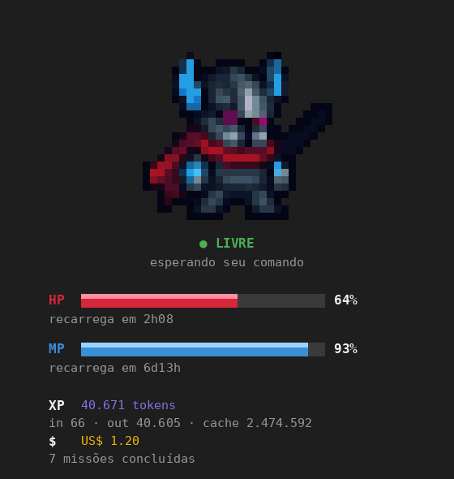
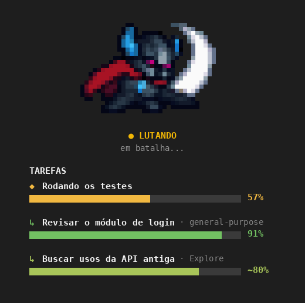
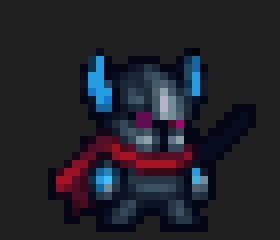
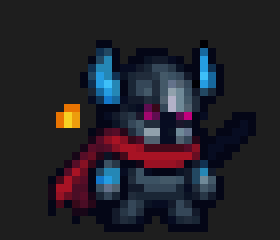
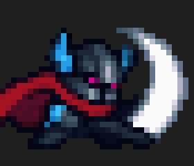
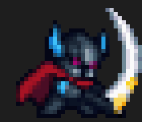
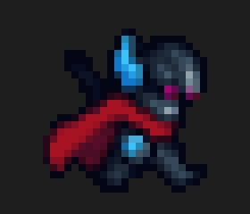
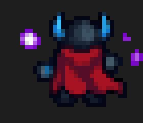
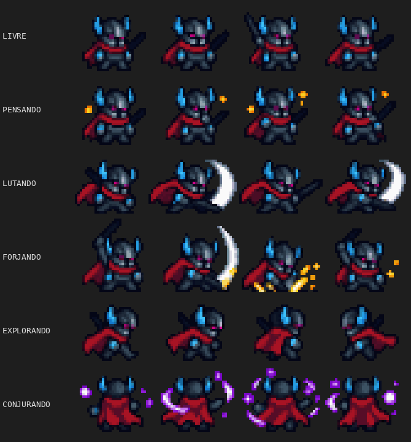
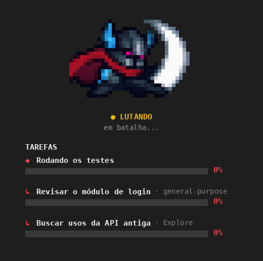

<div align="center">

# ⚔️ Knight Pane

**Um cavaleiro em pixel art que mora ao lado do seu chat no Claude Code.**
Ele luta, forja, explora e conjura de acordo com o que o Claude está fazendo, e ainda mostra seu HP, MP, tokens e custo.





*Imagem ilustrativa do painel, renderizada a partir dos mesmos sprites do mod.*

</div>

## ✨ O que ele faz

Knight Pane é um **mod** do Claude Code: abre um painel lateral com um cavaleiro animado e um pequeno HUD de jogo.

- 🧙 **Reage ao que o Claude faz:** o cavaleiro muda de animação conforme a ferramenta em uso.
- ❤️ **HP:** quanto resta da sua janela de uso de **5 horas**, com o tempo para recarregar.
- 💙 **MP:** quanto resta da janela de **7 dias**, com o tempo para recarregar.
- 🏆 **XP:** tokens de entrada, saída e cache da sessão.
- 💰 **Custo:** o gasto da sessão em US$, em amarelo.
- 📜 **Missões:** quantos turnos o cavaleiro já concluiu.
- 📋 **Tarefas dos agentes:** uma barra de progresso para o agente principal e para cada subagente, com o título do que ele está fazendo. A barra vai de 0% a 100% e muda de cor no caminho (vermelho → laranja → amarelo → verde).
- 🌊 **Barras animadas:** uma onda de brilho percorre a barra e, com 20% ou menos, ela pulsa em alerta.

## 🎭 Os estados do cavaleiro

| Estado | Quando aparece | Animação |
|---|---|---|
| **LIVRE** (verde) | nenhum turno em andamento |  |
| **PENSANDO** | turno em andamento, sem ferramenta rodando |  |
| **LUTANDO** | qualquer outra ferramenta |  |
| **FORJANDO** | `Edit`, `Write`, `NotebookEdit`, `MultiEdit` |  |
| **EXPLORANDO** | `Read`, `Grep`, `Glob`, `WebSearch`, `WebFetch`, `LS` |  |
| **CONJURANDO** | `Bash` |  |

Só as ferramentas da conversa principal contam: o trabalho de subagentes não muda o estado.

<details>
<summary>Ver todos os quadros do sprite</summary>



</details>

## 📋 Barras de tarefas dos agentes

Cada agente ou subagente em andamento ganha uma barra com o seu título. Veja como fica, com um agente principal e dois subagentes trabalhando ao mesmo tempo:



*Imagem ilustrativa: o painel real é desenhado no terminal com blocos coloridos, mas o visual segue a mesma lógica.*

A cor da barra muda conforme ela enche:

| 0% | ~35% | ~65% | 100% |
|---|---|---|---|
| 🟥 vermelho | 🟧 laranja | 🟨 amarelo | 🟩 verde, com ✓ |

Legenda: `◆` é o agente principal, `↳` é um subagente (com o tipo dele ao lado) e `~` marca uma porcentagem estimada.

- **Título:** para o agente principal, a etapa em andamento da lista de tarefas (ou o começo do seu pedido); para um subagente, a descrição com que ele foi chamado, mais o tipo dele.
- **Progresso real:** quando o agente usa uma lista de tarefas (`TodoWrite`), a porcentagem é `concluídas ÷ total`.
- **Progresso estimado:** sem lista, o Claude Code não informa quanto falta, então a barra **cresce com o número de ferramentas usadas** e para em ~90%. Esse valor aparece com um `~` (por exemplo `~45%`).
- **Conclusão:** ao terminar, a barra vai a 100%, fica verde com um ✓ e some depois de alguns segundos.

## 📦 Instalação

No prompt de uma sessão do Claude Code:

```
/plugin install knight-pane --marketplace danilosong/knight-pane-claude
```

Ou, a partir de um shell:

```
claude plugin install knight-pane --marketplace danilosong/knight-pane-claude
```

Responda `y` para adicionar o marketplace e escolha o escopo (o de usuário vale para todas as sessões).

Na versão desktop, onde `/plugin` não roda: clique em **+** ao lado da caixa de mensagem, depois em **Plugins → Add marketplace** com `danilosong/knight-pane-claude` e então **Add plugin**.

## 🚀 Uso

O painel abre sozinho quando a sessão começa. Para abri-lo de novo:

```
/knight
```

O painel só abre se o terminal tiver largura suficiente (cerca de 110 a 144 colunas); abaixo disso ele espera até caber.

## 📝 Observações

- HP e MP vêm dos limites de uso da conta. Fora de uma assinatura eles mostram "sem leitura".
- Os tokens de XP contam a partir do momento em que o mod carrega.
- Os sprites foram convertidos de uma folha desenhada à mão para o terminal, usando meio-blocos coloridos (`▀`), então precisam de um terminal com cores 24 bits.
- Em alguns quadros da folha original a espada aparece na outra mão; esses quadros são pulados na animação.

## 🛠️ Como é feito

Um único módulo de hooks (`hooks/register.tsx`) que:

- escuta `turn.start`, `turn.complete`, `tool.call` e `session.measure` para saber o que o Claude faz e quanto você usou;
- redesenha o painel a cada ~350 ms com um relógio (`$.clock.every`);
- guarda os valores em `$.state`, declarados em `types/index.d.ts`.

## 📄 Licença

[MIT](LICENSE)
